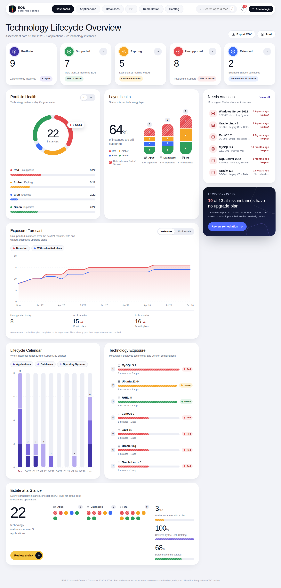

# EOS Command Center

Technology Lifecycle & End-of-Support review for Web apps, backend Apps and Databases, built for
Application / Platform owners and the quarterly CTO review.

**Stack:** React 18 (Vite) behind nginx · FastAPI · PostgreSQL · Docker Compose. No charting library:
every chart is hand-built SVG, so there is nothing extra to install.



> Screenshots in `docs/` are rendered from the bundled sample data.

## Run it

```bash
cp .env.example .env          # set ADMIN_PASSWORD
docker compose up --build
```

Dashboard **http://localhost:3000** · API docs **http://localhost:8000/docs**.
First boot seeds 9 sample apps (22 components) and a 35-entry technology catalog.
Upgrading from an earlier version of this project? This release changes the frontend only, so a plain
`docker compose up --build` is enough (no `-v` / database reset needed).

## Views

| View | What it gives you |
|---|---|
| **Dashboard** | KPI cards, Portfolio Health ring, Layer Health, **Exposure Forecast**, Lifecycle Calendar, Technology Exposure, Estate at a Glance, and a *Needs Attention* rail. |
| **Applications / Databases / OS** | One focused table per technology layer: status filter chips, search, sortable columns, no sideways scrolling. |
| **Remediation** | Red/Amber instances grouped by owner, with plan progress, overdue flags and one-click **Email reminder**. |
| **Catalog** | Approved technologies with EOSS / EOES dates, how many instances use each, and how many are out of sync. |

Click any row, dot, KPI or list item to open the **detail drawer** (owners, per-component support timeline,
upgrade plan, email-the-owner). Drawers stack: status list → application → Back.

### Things worth knowing
- **Exposure Forecast** shows how many instances will be unsupported each month for 24 months, with and without
  submitted upgrade plans. It assumes a plan completes on its target date; **plans already past their target date
  are not credited**, because the instance is evidently still on the old version.
- **Supported %** = instances not past End of Support (Green + Amber + Blue).
- **Support ends** is the date support *really* ends: the Extended (EOES) date when one extends past standard
  support, otherwise EOSS. This mirrors the backend status rule.
- **Catalog alignment** (Estate card): *covered* = component's layer/technology/version exists in the catalog;
  *dates match* = its dates equal the catalog's. Re-pick the catalog entry in *Edit application* to resync.
- Nothing is invented: there are no trend arrows because the app doesn't store history. (A snapshot table is the
  natural next step if you want quarter-over-quarter deltas.)

### Shortcuts & conveniences
`/` focuses search · `Esc` closes drawers and dialogs · every view has a shareable URL (`#/databases`, `#/remediation`…)
· **Export CSV** on the dashboard and each layer (respects current filters, spreadsheet-safe) · **Print** gives a
clean one-page-per-section pack for the quarterly review · keyboard-operable, skip link, reduced-motion aware.

## Status logic (RAG + Blue), computed server-side per component

| Status | Meaning | Rule |
|---|---|---|
| 🟢 Green | More than 18 months to End of Support | `eol_date` > today + 18 months |
| 🟡 Amber | Less than 18 months | today < `eol_date` ≤ today + 18 months |
| 🔴 Red | Past End of Support | today > `eol_date` and not in extended support |
| 🔵 Blue | Extended Support | `eol_date` < today ≤ `extended_support_date` |

Threshold: `AMBER_THRESHOLD_MONTHS` in `backend/app/status.py`.

## Data model
Each **App** (identity + owners) has one or more **Components** (Application / Database / OS), each with its own
technology, version, EOSS, EOES, status and upgrade plan. The **Tech Catalog** is the approved list that
auto-fills those dates when onboarding or editing. `data/apps_sample.xlsx` shows the import format: one row per
component, rows sharing an `app_id` form one application.

## Admin Mode
Sign in with `ADMIN_PASSWORD`. A green banner shows while it's active. Admin Mode adds: onboard / edit / delete
applications, **Import Excel**, submit or update upgrade plans, and manage catalog entries. If the session
expires you're returned to User Mode with a clear message rather than a silent failure.

**MVP caveat:** one shared password for everyone (administrators and owners alike). It is not per-owner identity,
so anyone with the password can edit any app. `PATCH /api/components/{id}/upgrade-plan` is already shaped for
per-owner tokens (magic link / SSO) as a follow-up; do that before widening access beyond a small trusted group.

## API (also at `/docs`) — unchanged in this release
`POST /api/auth/login` · `GET /api/apps` · `GET /api/apps/{id}` · `GET /api/summary` · `POST|PUT|DELETE /api/apps…` ·
`PATCH /api/components/{id}/upgrade-plan` · `POST /api/apps/import` · `GET|POST|PUT|DELETE /api/catalog…`

## Using MySQL instead of Postgres
Swap the `db` image for `mysql:8`, add `pymysql` to `backend/requirements.txt`, set
`DATABASE_URL=mysql+pymysql://user:pass@db:3306/eos_db`. No model or API changes.

## Not in this MVP
Per-owner authentication · history/snapshots and trend deltas · server-side email sending (reminders open your mail
client via `mailto:`) · audit log · read-only CTO role.
